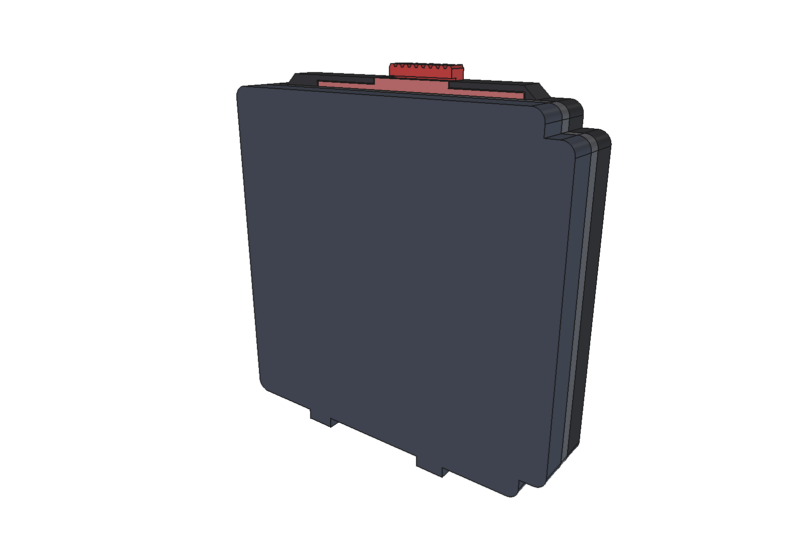
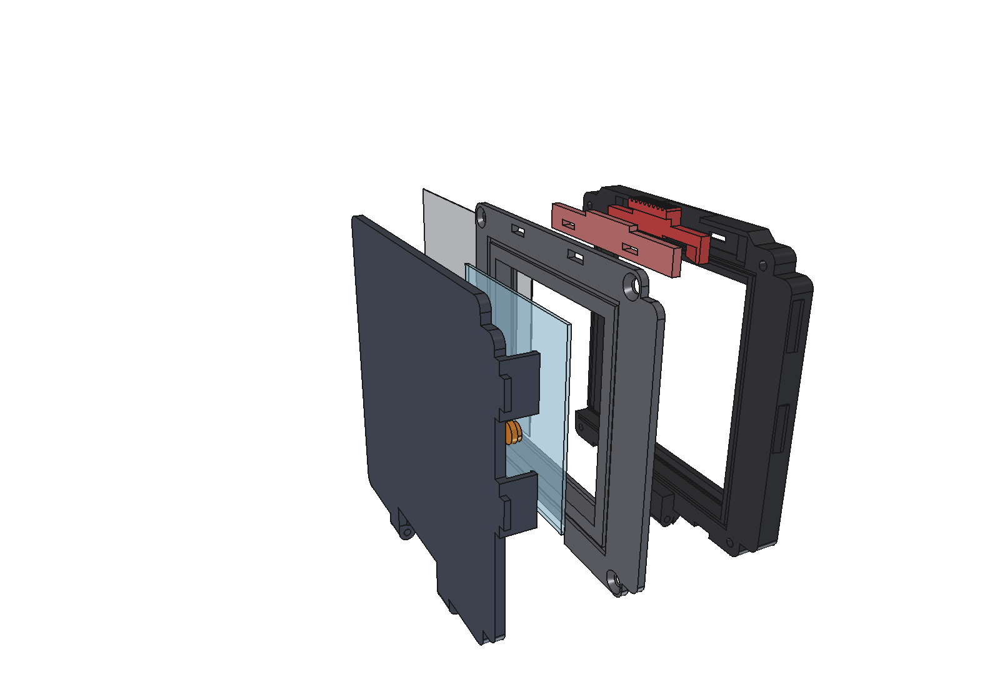

# Cassette ferrotype 57 × 57 pour Hasselblad V

Cassette imprimée en 3D pour faire des ferrotypes et des ambrotypes (collodion
humide) sur plaque de 57 × 57 mm, de 1 à 3 mm d'épaisseur, avec un boîtier
Hasselblad de la série 500.
Elle se monte à la place du magasin A12, avec les crochets et le verrou d'origine
du boîtier, et place l'émulsion au plan film, à 3,55 mm derrière la face d'appui.
Le volet s'insère par la gauche.




## Télécharger

Les STL, STEP et le fichier FreeCAD sont publiés dans les
[Releases](../../releases) ; ils ne sont pas versionnés dans le dépôt.

| Fichier | Pièce | À imprimer |
|---|---|---|
| `piece1_interface.stl` | Contre le boîtier : crochets, verrou (taquet du ressort), fente du volet, ouverture 55 × 55, gorges des deux lèvres du boîtier | Face d'appui (côté boîtier) sur le plateau |
| `piece2_cadre_verre.stl` | Cadre du verre : logement 57,4, butée et ouverture 55, rails du volet, chicanes, deux gorges anti-lumière, deux logements d'aimants Ø6 × 2 dans les coins opposés à la charnière | Face arrière (côté couvercle) sur le plateau |
| `piece3_couvercle.stl` | Couvercle articulé plein, dans le prolongement des pièces (on ouvre volet en place) : chambre du ressort, deux nervures anti-lumière, tenon du ressort avec son trou d'insert M3, deux logements d'aimants Ø6 × 2 dans les coins opposés à la charnière | Face extérieure sur le plateau ; 4 périmètres et remplissage élevé contre la lumière |
| `piece3_couvercle_pour_v0.1.stl` | Couvercle-boîte à clips pour des pièces 1 et 2 imprimées en v0.1 (`tools/lid_for_v0_1.py`), avec le ressort de la v0.1 | Face extérieure sur le plateau |
| `ressort_croix.stl` | Ressort en croix qui presse le dos de la plaque, pour des verres de 1 à 3 mm (bras longs et fins), vissé dans le tenon du couvercle (bossage fraisé côté verre) | Face plate sur le plateau, pieds et bossage vers le haut, 100 % de remplissage, PETG |
| `glissiere_verrou.stl` | Glissière du verrou (dessin de Rayfor, remodélisé) | À plat, face côté boîtier sur le plateau |
| `capot_verrou.stl` | Capot de la glissière (idem) | Face visible (arrière, à fleur de la pièce 1) sur le plateau |
| `cassette_ferrotype.FCStd` | Modèle FreeCAD en esquisses, toutes les cotes dans la feuille `Parametres` | — |
| `cassette_boitier.3mf` | Plateau Bambu Studio du boîtier : pièces 1, 2 et couvercle orientées et placées, PLA noir, réglages par pièce (voir « Plateaux d'impression ») | Ouvrir dans Bambu Studio |
| `cassette_ressort.3mf` | Plateau Bambu Studio du ressort, de la glissière et du capot, PETG vert, 0,12 mm | Ouvrir dans Bambu Studio |

Matière : boîtier (pièces 1, 2 et couvercle) en PLA noir, ressort et petites pièces
du verrou en PETG (plus souple, il ne casse pas à la flexion). Le PLA ramollit vers
55 °C : ne pas laisser la cassette au soleil ni dans une voiture ; en PETG noir ou
en ASA, le boîtier tient mieux la chaleur. Couches de 0,12 à 0,16 et 4 périmètres
pour les pièces 1 et 2 : en brouillon (0,28), les parois fines sortent trop
épaisses et les rampes en escalier.

## Quincaillerie

- 4 vis M3 × 8 à tête fraisée, auto-taraudées dans la pièce 1 (deux dans les coins
  du bas, une en haut à gauche du verrou, une sur le talon droit).
- 4 aimants néodyme Ø6 × 2 mm (N52 ou N45, aimantés dans l'épaisseur), collés
  après l'impression : deux dans les coins hauts de la pièce 2, deux en face dans
  le couvercle. Couvercle fermé, 0,6 mm d'air les sépare.
- Colle pour les aimants : cyanoacrylate (gel) ou époxy.
- 1 axe de charnière Ø2 × 44 mm (tige acier ou clou coupé).
- Velours ou feutrine adhésive, 3 mm de large, 0,5 à 0,7 mm d'épaisseur,
  2 bandes de 66 mm : à l'entrée de la fente du volet, une sur chaque pièce.
- Volet : plaque métal de 65,88 mm de large, 0,35 mm d'épaisseur au plus
  (fente de 66,38 × 0,4), environ 88 mm de long dont 73 engagés.
- 1 insert fileté M3 à chaud, M3 × 5,7 (type Ruthex, trou Ø4), dans le tenon du
  couvercle.
- 1 vis M3 × 6 à tête fraisée (ISO 10642) pour le ressort.
- 1 ressort de compression Ø2 × 10 mm pour le verrou.

## Aimants collés (après l'impression)

Pas de pause d'impression : les logements débouchent sur les faces qui se touchent,
la face arrière de la pièce 2 et la face intérieure du couvercle. Ils font
Ø6,4 × 2,3 pour des aimants Ø6 × 2. Le jeu de 0,4 au diamètre laisse entrer
l'aimant sans forcer. Les 0,3 de profondeur en plus laissent la place à la colle
au fond : l'aimant reste en retrait de la face et ne dépasse jamais. Une goutte de
colle au fond, l'aimant enfoncé jusqu'à la colle, sans en mettre sur la face.

**Polarité** (on ne peut plus la changer une fois collé) : coller deux aimants
l'un sur l'autre et marquer au feutre les deux faces en contact. Dans la pièce 2
comme dans le couvercle, face marquée **visible** (vers la face de joint) : couvercle
fermé, les faces marquées se retrouvent face à face et s'attirent. Vérifier en
présentant le couvercle avant que la colle ne prenne.

## Plateaux d'impression (Bambu Studio)

`tools/plateau.py` (interpréteur de FreeCAD, après le build) écrit deux projets
Bambu Studio pour X1 Carbon, plaque PEI texturée, dans `exports/plateau/` :

- `cassette_boitier.3mf` : pièces 1, 2 et couvercle, Bambu PLA Basic noir,
  0,16 mm Optimal ; pièces 1 et 2 : 4 parois, remplissage 25 % ; couvercle :
  4 parois, 50 %.
- `cassette_ressort.3mf` : ressort en croix, glissière et capot du verrou, Bambu
  PETG Basic vert, 0,12 mm Fine, remplissage 100 %.

Chaque pièce a sa face visible ou sa plus grande face plate sur le plateau, comme
dans le tableau plus haut. Les préréglages de chaque plateau sont dans
`cad/bambu/boitier.config` et `cad/bambu/ressort.config`, refaits par `--settings`.

## Montage

1. Poser la glissière dans sa poche, à l'arrière de la pièce 1, languette
   moletée vers le haut. Glisser le ressort du verrou sous la glissière, entre
   sa dent gauche et le taquet de la poche, puis poser le capot par-dessus.
2. Coller les deux bandes de velours.
3. Emboîter la pièce 2 dans la pièce 1 : les deux chicanes s'engagent dans leurs
   gorges. Visser les 4 vis M3.
4. Poser l'insert M3 au fer dans le tenon du couvercle, à fleur. Visser le
   ressort dessus avec la vis M3 × 6 fraisée, pieds vers la plaque : la tête
   affleure le bossage.
5. Monter la charnière avec l'axe Ø2.

Sur le boîtier : pousser la languette de la glissière vers la droite (vue de
l'arrière) et la tenir, accrocher le bas sur les crochets, rabattre le haut,
puis relâcher. Le ressort ramène la glissière vers la gauche : les griffes du
boîtier montent sur la rampe des dents et plaquent la cassette.

## Étanchéité à la lumière

- Face d'appui : deux gorges reçoivent les deux lèvres du boîtier, celle de
  la lèvre intérieure (carré 59 → 61, 1 mm de profondeur) autour de
  l'ouverture de 55 × 55.
- Entre la pièce 1 et la pièce 2 : une nervure en U sous la collerette et une
  nervure sous les rails du volet, chacune dans une gorge.
- Couvercle : plein, posé à plat sur la pièce 2, avec deux nervures dans deux
  gorges autour de la chambre du ressort, sur les 4 côtés. Au-dessus de la
  chambre, 4,45 mm de matière contre la lumière.
- Valider par un essai : papier photo dans la cassette fermée, 10 min au soleil,
  puis développement.
- Fente du volet : velours des deux côtés.
- Les fenêtres des griffes, en haut, sont hors de la zone étanche : on y voit la
  glissière, c'est normal.

## Modifier une cote

**Dans FreeCAD** : ouvrir `cassette_ferrotype.FCStd`, changer la valeur dans la
feuille `Parametres` (colonne B ; les cotes dérivées sont des formules), puis
recalculer (Ctrl+R). Les noms de la feuille sont en français, dans le repère vu
de l'arrière (côté photographe) : X vers la droite (`_gauche`, `_droite`), Y vers
le haut (`_bas`, `_haut`), Z = profondeur depuis la face d'appui du boîtier.

Chaque pièce est un corps PartDesign construit comme à la main : un contour
extrudé (coins arrondis dans l'esquisse), des plans de référence nommés (« Plan
face arrière »…), des poches à leur vraie profondeur ou « à travers tout », des
perçages (fonction Perçage, fraisures comprises), une seule moitié dessinée puis
une symétrie, et des répétitions (moletage, bras du ressort). Les
esquisses sont cotées comme un plan : largeurs, hauteurs, diamètres, rayons
égaux, symétrie sur les axes quand un profil est centré, sinon `position_x` /
`position_y` depuis l'axe. Les cotes portent un nom (`largeur_plaque`,
`hauteur_talon`, `rayon_coins`, `diametre`…) et affichent la formule de la
feuille qui les pilote (icône ƒx) : une cote pilotée se change dans la feuille,
pas dans l'esquisse. Exporter ensuite le corps en STL.

Les pièces sont réunies dans l'assemblage **Cassette** (atelier Assemblage), par
des liaisons : pièce 1 fixe, pièce 2 et capot fixés dessus, couvercle en
**pivot** sur la charnière (butée à `couvercle_ouverture_max`), ressort fixé au
couvercle, glissière du verrou en **glissière** sur sa course, aimants fixés dans
leurs logements. Pour ouvrir le couvercle : double-cliquer *Cassette*, puis
faire glisser le couvercle à la souris.

Deux animations sont prêtes (Cassette › Simulations) : *Ouvrir et fermer le
couvercle* (jusqu'à la butée) et *Verrouiller et déverrouiller*. Atelier
**Assembly**, double-cliquer *Cassette*, puis double-cliquer l'animation,
cliquer **Générer** (*Generate*) et lancer la lecture sous la barre des images. Les liaisons s'appuient sur des repères
(« Repère charnière »…) placés par la feuille, jamais sur une arête : elles
suivent les changements de cotes.

**Par le script** (régénère le FCStd, les STL, les STEP et les contrôles) :
changer l'expression dans `PARAMS`, en tête de
[cad/build_cassette.py](cad/build_cassette.py), puis

```
/Applications/FreeCAD.app/Contents/Resources/bin/python cad/build_cassette.py
/Applications/FreeCAD.app/Contents/Resources/bin/python cad/sections.py
```

Le script réécrit le FCStd : un changement fait seulement dans FreeCAD est perdu
s'il n'est pas reporté dans `PARAMS`. La table est aussi écrite dans
[cad/parameters.csv](cad/parameters.csv). Le script vérifie qu'aucune esquisse
n'a de degré libre, qu'aucune pièce n'en chevauche une autre (verre, volet,
glissière en position ouverte et verrouillée compris) et que le couvercle s'ouvre
jusqu'à 120° sans rien accrocher.

Publier une version : `tools/release.sh v0.1 "notes"` (construit puis crée la
release GitHub avec `gh`). Captures d'écran : `tools/screenshots.py`, à lancer
avec `/Applications/FreeCAD.app/Contents/MacOS/FreeCAD`.

## Dossiers

- `cad/` : générateur du modèle, table des paramètres, coupes.
- `docs/` : [cotes et sources](docs/COTES.md), plan de l'interface, coupes,
  captures.
- `tools/` : relevé de l'interface sur les STL de Rayfor, captures, release.
- `sources/` : la monture V de Rayfor (référence des cotes et des pièces du
  verrou), voir [sources/README.md](sources/README.md).

## Crédits et licence

L'interface du boîtier, la glissière et le capot du verrou reprennent la
monture V pour dos Imacon de **Rayfor**
([Printables](https://www.printables.com/model/548055-hasselblad-v-mount-for-imacon-digital-back)),
publiée en CC BY-NC-SA 4.0. Ce projet est donc publié sous la même licence :
[CC BY-NC-SA 4.0](LICENSE.md). Pas d'usage commercial.
