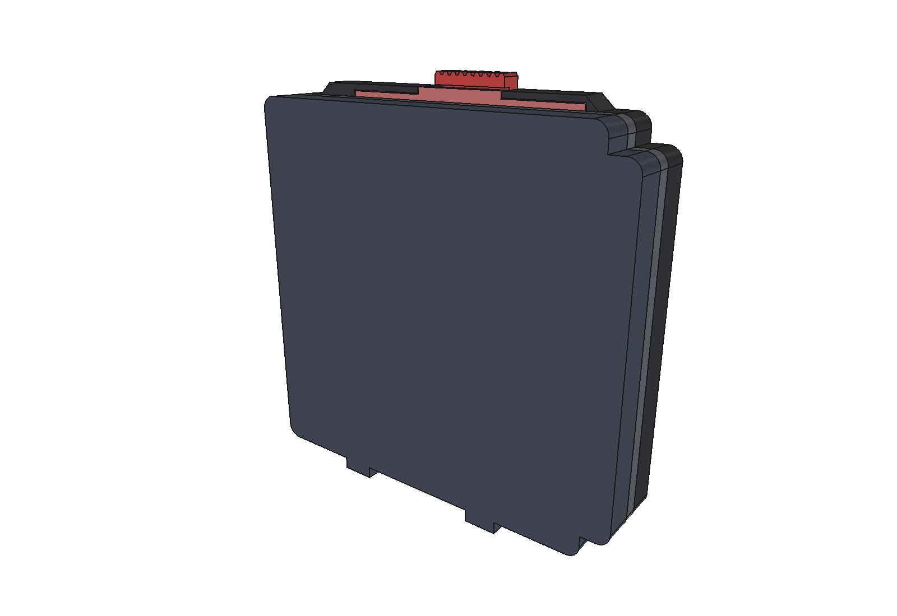
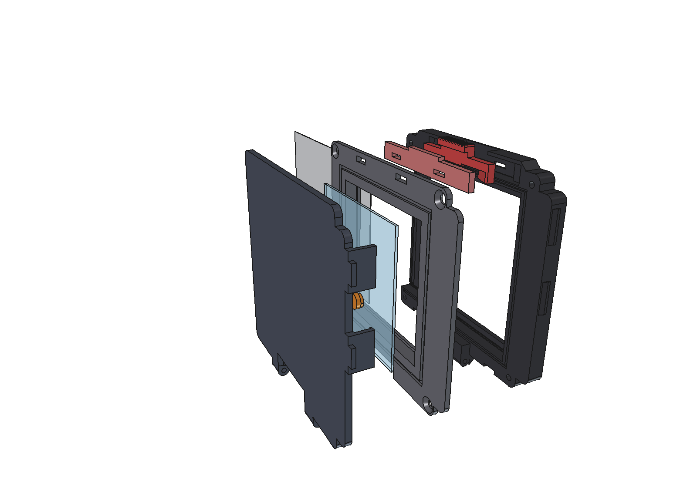

# Cassette ferrotype 57 × 57 pour Hasselblad V

Cassette imprimée en 3D pour faire des ferrotypes et des ambrotypes (collodion
humide) sur plaque de 57 × 57 mm, de 1 à 3 mm d'épaisseur, avec un boîtier
Hasselblad de la série 500.
Elle se monte à la place du magasin A12, avec les crochets et le verrou d'origine
du boîtier, et place l'émulsion au plan film, à 3,55 mm derrière la face d'appui.
Le volet s'insère par la gauche.




## Télécharger

Les STL, STEP et le fichier FreeCAD sont publiés dans les
[Releases](../../releases) ; ils ne sont pas versionnés dans le dépôt.

| Fichier | Pièce | À imprimer |
|---|---|---|
| `piece1_interface.stl` | Contre le boîtier : crochets, verrou, fente du volet, ouverture 55 × 55, gorges des deux lèvres du boîtier | Face d'appui (côté boîtier) sur le plateau |
| `piece2_cadre_verre.stl` | Cadre du verre : logement 57,4, butée et ouverture 55, rails du volet, chicanes, couloir et deux rails en queue d'aronde du couvercle coulissant, deux aimants Ø6 × 2 incrustés (en haut et en bas, côté droit) | Face arrière (côté couvercle) vers le plateau : elle repose sur la lèvre gauche (1,2 mm), **supports sous le reste de la face** ; **pause à 3,80 mm** pour poser les aimants |
| `piece3_couvercle.stl` | Couvercle plein qui coulisse vers la droite, imperdable (on ouvre volet en place) : semelle, languettes et queues d'aronde des rails, lèvre de fermeture à droite, chambre du ressort à lames, deux aimants Ø6 × 2 incrustés | Face extérieure sur le plateau ; **pause à 7,00 mm** pour poser les aimants ; 4 périmètres et remplissage élevé contre la transparence du PETG |
| `piece3_couvercle_pour_v0.1.stl` | Couvercle-boîte à clips pour des pièces 1 et 2 imprimées en v0.1 (`tools/lid_for_v0_1.py`), avec le ressort de la v0.1 | Face extérieure sur le plateau |
| `ressort_lames.stl` | Ressort à deux lames qui presse le dos de la plaque, pour des verres de 1 à 3 mm ; patins chanfreinés qui montent les marches quand le couvercle glisse | Face plate sur le plateau, patins vers le haut, 100 % de remplissage, PETG |
| `glissiere_verrou.stl` | Glissière du verrou (dessin de Rayfor, remodélisé) | À plat, face côté boîtier sur le plateau |
| `capot_verrou.stl` | Capot de la glissière (idem) | À plat |
| `cassette_ferrotype.FCStd` | Modèle FreeCAD en esquisses, toutes les cotes dans la feuille `Parametres` | — |

Matière : PETG noir (ou ASA), pas de PLA (nitrate d'argent, chaleur). Couches de
0,12 à 0,16 et 4 périmètres pour les pièces 1 et 2 : en brouillon (0,28), les
parois fines sortent trop épaisses et les rampes en escalier.

## Quincaillerie

- 4 vis M3 × 8 à tête fraisée, auto-taraudées dans la pièce 1 (deux dans les coins
  du bas, une en haut de chaque côté du verrou).
- 4 aimants néodyme Ø6 × 2 mm (N52 ou N45, aimantés dans l'épaisseur), incrustés
  à l'impression : deux dans la pièce 2 (bandes du haut et du bas, côté droit),
  deux en face dans le couvercle. Couvercle fermé, 1 mm de plastique les sépare (deux peaux de 0,4 et
  le jeu de 0,2).
- 2 goupilles de butée du couvercle : bouts de tige Ø2 × 4,7 mm (acier ou clou coupé).
- Velours ou feutrine adhésive, 3 mm de large, 0,5 à 0,7 mm d'épaisseur,
  2 bandes de 66 mm : à l'entrée de la fente du volet, une sur chaque pièce.
- Volet : plaque métal de 65,88 mm de large, 0,35 mm d'épaisseur au plus
  (fente de 66,38 × 0,4), environ 88 mm de long dont 73 engagés.
- Colle cyano pour fixer la racine du ressort à lames sous le couvercle.
- 1 ressort de compression Ø2 × 10 mm pour le verrou.

## Aimants incrustés (pendant l'impression)

Les logements des aimants sont fermés : il faut une pause d'impression pour les
poser, à 3,80 mm pour la pièce 2 (face arrière vers le plateau, sur sa lèvre gauche) et à 7,00 mm pour
le couvercle (face extérieure sur le plateau). Ces hauteurs valent pour des aimants de
2 mm ; le build les recalcule et les affiche si l'on change `aimant_epaisseur`. Dans le trancheur, insérer la
pause avant le premier calque au-dessus de cette hauteur. Logements Ø6,2 × 2,2 :
l'aimant tombe au fond, il reste 0,2 au-dessus pour que la buse ne le touche pas.

**Polarité** (on ne peut plus la changer ensuite) : coller deux aimants l'un sur
l'autre et marquer au feutre les deux faces en contact. Dans la pièce 2, face
marquée **vers le plateau** ; dans le couvercle, face marquée **vers le haut**.

## Montage

1. Poser la glissière dans sa poche, à l'arrière de la pièce 1, languette
   moletée vers le haut. Glisser le ressort du verrou sous la glissière, entre
   sa dent gauche et le taquet de la poche, puis poser le capot par-dessus.
2. Coller les deux bandes de velours.
3. Coller la racine du ressort à lames dans son logement sous le couvercle,
   patins vers le bas.
4. Engager le couvercle dans les rails de la pièce 2 par la droite, et le pousser
   jusqu'à la lèvre.
5. Poser les deux goupilles Ø2 par l'avant de la pièce 2, dans les trous au bout
   droit des rails, puis emboîter la pièce 2 dans la pièce 1 : les deux chicanes
   s'engagent dans leurs gorges, et la pièce 1 enferme les goupilles. Visser les
   4 vis M3. Le couvercle est imperdable ; pour le sortir, dévisser la pièce 2.

Sur le boîtier : pousser la languette de la glissière vers la droite (vue de
l'arrière) et la tenir, accrocher le bas sur les crochets, rabattre le haut,
puis relâcher. Le ressort ramène la glissière vers la gauche : les griffes du
boîtier montent sur la rampe des dents et plaquent la cassette.

## Étanchéité à la lumière

- Face d'appui : deux gorges reçoivent les deux lèvres du boîtier, celle de
  la lèvre intérieure (carré 59 → 61, 1 mm de profondeur) autour de
  l'ouverture de 55 × 55.
- Entre la pièce 1 et la pièce 2 : une nervure en U sous la collerette et une
  nervure sous les rails du volet, chacune dans une gorge.
- Couvercle coulissant : en haut et en bas, une languette sur toute sa longueur
  dans la gorge de chaque rail ; à gauche, une lèvre de la pièce 2 le long du
  bord, coiffée par une feuillure du couvercle, et une languette au bout de la
  semelle qui entre dans une fente de la pièce 2 en fin de course ; à droite, la lèvre
  qui descend devant la face du talon (butée de fermeture). Au-dessus de la
  chambre des lames, 4 mm de matière contre la transparence du PETG.
- Valider par un essai : papier photo dans la cassette fermée, 10 min au soleil,
  puis développement.
- Fente du volet : velours des deux côtés.
- Les fenêtres des griffes, en haut, sont hors de la zone étanche : on y voit la
  glissière, c'est normal.

## Modifier une cote

**Dans FreeCAD** : ouvrir `cassette_ferrotype.FCStd`, changer la valeur dans la
feuille `Parametres` (colonne B ; les cotes dérivées sont des formules), puis
recalculer (Ctrl+R). Les noms de la feuille sont en français, dans le repère vu
de l'arrière (côté photographe) : X vers la droite (`_gauche`, `_droite`), Y vers
le haut (`_bas`, `_haut`), Z = profondeur depuis la face d'appui du boîtier.

Chaque pièce est un corps PartDesign construit comme à la main : un contour
extrudé (coins arrondis dans l'esquisse), des plans de référence nommés (« Plan
face arrière »…), des poches à leur vraie profondeur ou « à travers tout », des
perçages (fonction Perçage, fraisures comprises), une seule moitié dessinée puis
une symétrie, et des répétitions (moletage, bras du ressort). Les
esquisses sont cotées comme un plan : largeurs, hauteurs, diamètres, rayons
égaux, symétrie sur les axes quand un profil est centré, sinon `position_x` /
`position_y` depuis l'axe. Les cotes portent un nom (`largeur_plaque`,
`hauteur_talon`, `rayon_coins`, `diametre`…) et affichent la formule de la
feuille qui les pilote (icône ƒx) : une cote pilotée se change dans la feuille,
pas dans l'esquisse. Exporter ensuite le corps en STL.

Les pièces sont réunies dans l'assemblage **Cassette** (atelier Assemblage), par
des liaisons : pièce 1 fixe, pièce 2 et capot fixés dessus, couvercle en
**glissière** vers la droite (course `couvercle_course`), ressort à lames fixé au
couvercle, glissière du verrou en **glissière** sur sa course, aimants fixés dans
leurs logements. Pour ouvrir le couvercle : double-cliquer *Cassette*, puis
faire glisser le couvercle à la souris.

Deux animations sont prêtes (Cassette › Simulations) : *Ouvrir et fermer le
couvercle* (sur toute sa course) et *Verrouiller et déverrouiller*. Atelier
**Assembly**, double-cliquer *Cassette*, puis double-cliquer l'animation,
cliquer **Générer** (*Generate*) et lancer la lecture sous la barre des images. Les liaisons s'appuient sur des repères
(« Repère glissière couvercle »…) placés par la feuille, jamais sur une arête : elles
suivent les changements de cotes.

**Par le script** (régénère le FCStd, les STL, les STEP et les contrôles) :
changer l'expression dans `PARAMS`, en tête de
[cad/build_cassette.py](cad/build_cassette.py), puis

```
/Applications/FreeCAD.app/Contents/Resources/bin/python cad/build_cassette.py
/Applications/FreeCAD.app/Contents/Resources/bin/python cad/sections.py
```

Le script réécrit le FCStd : un changement fait seulement dans FreeCAD est perdu
s'il n'est pas reporté dans `PARAMS`. La table est aussi écrite dans
[cad/parameters.csv](cad/parameters.csv). Le script vérifie qu'aucune esquisse
n'a de degré libre, qu'aucune pièce n'en chevauche une autre (verre, volet,
glissière en position ouverte et verrouillée compris), que le couvercle glisse
sur toute sa course sans rien accrocher, que les goupilles le retiennent et que
les patins du ressort à lames montent toutes les marches de leur chemin.

Publier une version : `tools/release.sh v0.1 "notes"` (construit puis crée la
release GitHub avec `gh`). Captures d'écran : `tools/screenshots.py`, à lancer
avec `/Applications/FreeCAD.app/Contents/MacOS/FreeCAD`.

## Dossiers

- `cad/` : générateur du modèle, table des paramètres, coupes.
- `docs/` : [cotes et sources](docs/COTES.md), plan de l'interface, coupes,
  captures.
- `tools/` : relevé de l'interface sur les STL de Rayfor, captures, release.
- `sources/` : la monture V de Rayfor (référence des cotes et des pièces du
  verrou), voir [sources/README.md](sources/README.md).

## Crédits et licence

L'interface du boîtier, la glissière et le capot du verrou reprennent la
monture V pour dos Imacon de **Rayfor**
([Printables](https://www.printables.com/model/548055-hasselblad-v-mount-for-imacon-digital-back)),
publiée en CC BY-NC-SA 4.0. Ce projet est donc publié sous la même licence :
[CC BY-NC-SA 4.0](LICENSE.md). Pas d'usage commercial.
